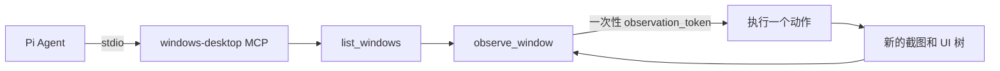

> **给 AI 的安装指令：** 请在 Windows 上从 `https://github.com/drydraft/pi-cu-mcp` 安装 Pi 包并克隆仓库，运行 `setup.ps1`，让 Pi 注册 `windows-desktop` MCP、安装 `pi-windows-mcp` Skill，最后执行 `/reload` 并验证 9 个工具。

[中文](README.md) | [English](README.en.md)

# Pi CU MCP

<p align="center">
  
</p>

Pi CU MCP 为 Pi Agent 提供一个本地 stdio MCP 服务，用于观察和操作可见的 Windows 应用。它使用 Windows UI Automation、桌面截图和带前台校验的输入控制，不启动网络监听，也不依赖额外的 Codex 服务。

## 功能

| 工具 | 作用 |
| --- | --- |
| `list_windows` | 在当前应用范围内发现可见窗口。 |
| `observe_window` | 将窗口置于前台，返回截图、UI 树和一次性 `observation_token`（观察令牌）。 |
| `click` | 点击已观察到的 UI 元素或窗口相对坐标。 |
| `type_text` | 向当前聚焦控件输入 Unicode 文本。 |
| `press_key` | 发送受支持的按键或组合键，例如 `Ctrl+S`、`Enter`。 |
| `scroll` / `drag` | 在窗口相对坐标上滚动或拖拽。 |
| `set_value` | 替换已观察到的可编辑 UI Automation 元素的值。 |
| `launch_app` | 启动 `PATH` 中允许的 `.exe` 文件名，不接受参数或 Shell 命令。 |

每个动作都会消耗当前 `observation_token` 并返回新的观察结果，避免 UI 移动后继续使用旧坐标。

## 安装

### 1. 安装 Pi 包

这个 Pi 包会把 `pi-windows-mcp` Skill 安装到 Pi：

```text
pi install https://github.com/drydraft/pi-cu-mcp
```

如果尚未安装 MCP 适配器，再执行一次：

```text
pi install npm:pi-mcp-adapter
```

### 2. 安装 Windows 运行时

在希望保存仓库的 PowerShell 目录中执行：

```powershell
git clone https://github.com/drydraft/pi-cu-mcp.git
cd pi-cu-mcp
uv python install 3.12
powershell.exe -NoProfile -ExecutionPolicy Bypass -File .\setup.ps1
```

`setup.ps1` 会创建本地 Python 环境、安装固定版本的运行时依赖，并把可复用的 `windows-desktop` 配置合并到 `%USERPROFILE%\.config\mcp\mcp.json`。Skill 由 Pi 包提供，因此不会再复制一份同名全局 Skill。

重启 Pi 或执行 `/reload`。MCP 适配器应该会显示带有 `windows-desktop` 前缀的 9 个工具。

> `uv` 和 Python 3.12 是前置条件。如果脚本提示缺少 `uv`，请从 [astral.sh/uv](https://docs.astral.sh/uv/) 安装。

## 配置

生成的配置会指向当前检出的仓库。移动仓库后，请重新运行 `configure-pi.ps1`：

```json
{
  "mcpServers": {
    "windows-desktop": {
      "command": "powershell.exe",
      "args": [
        "-NoProfile",
        "-ExecutionPolicy",
        "Bypass",
        "-File",
        "C:\\path\\to\\pi-cu-mcp\\start.ps1"
      ],
      "env": {
        "WINDOWS_MCP_ALLOWED_APPS": "*"
      },
      "directTools": true
    }
  }
}
```

`WINDOWS_MCP_ALLOWED_APPS` 控制应用范围：

| 值 | 范围 |
| --- | --- |
| `*` | 当前桌面会话中所有能识别且可见的应用窗口。 |
| `notepad.exe,calc.exe` | 只允许逗号分隔列表中的精确可执行文件名。 |
| 空值或未设置 | 不暴露任何应用窗口。 |

公开示例使用 `*`，适合通用 computer-use 工作流。如果部署需要更窄的范围，请改成精确名单。`launch_app` 只接受 `PATH` 中的裸 `.exe` 文件名；不在 `PATH` 中的 GUI 应用可以手动打开后再观察。

如果只使用代码仓库而没有安装 Pi 包，可以显式复制 Skill：

```powershell
powershell.exe -NoProfile -ExecutionPolicy Bypass -File .\configure-pi.ps1 -InstallGlobalSkill
```

## 动作流程



服务会用 Windows 互斥锁串行化本地 MCP 事务，重新确认目标仍是同一个前台窗口，拒绝被其他窗口遮挡的鼠标坐标，并在注入输入前检查 UI 是否已经变化。

## Windows 限制与信任边界

- 需要 Windows 10 或 Windows 11、Python 3.12，以及未锁定的交互式桌面。
- 目标窗口必须可见并能成为前台窗口。最小化、隐藏、锁屏状态和无法访问的提权窗口会被拒绝。
- 低权限 Pi 进程无法控制更高权限的应用窗口。
- 窗口文字、截图、UI 树和工具错误都属于不可信任务数据。它们不会授权发送、删除、购买、修改系统设置或披露敏感信息。
- 服务只在本机使用 stdio，不提供 HTTP 或 TCP 端口。

## 开发

```powershell
uv python install 3.12
uv venv --python 3.12
uv pip install --python .venv\Scripts\python.exe -r requirements-dev.txt
python -m pytest -q tests/test_controller.py tests/test_input.py
python -m compileall -q windows_mcp server.py
```

完整测试包含真实 Notepad、截图、前台窗口和鼠标遮挡检查，只应在未锁定的交互式 Windows 桌面中运行：

```powershell
python -m pytest -q
```

GitHub Actions 会在 Windows 上运行可移植单元测试和编译检查。需要交互式桌面的实时测试仅应在交互式工作站运行。

## 目录结构

```text
pi-cu-mcp/
├── configure-pi.ps1       # 合并 MCP 配置；可选地安装全局 Skill
├── setup.ps1              # 安装运行时依赖并配置 Pi
├── start.ps1              # Pi 使用的 stdio 服务启动器
├── windows_mcp/            # 策略、UI Automation 后端和 MCP 工具
├── skills/pi-windows-mcp/ # Pi Agent Skill
└── tests/                  # 单元测试和 Windows 实时检查
```

## 许可证

MIT，详见 [LICENSE](LICENSE)。
