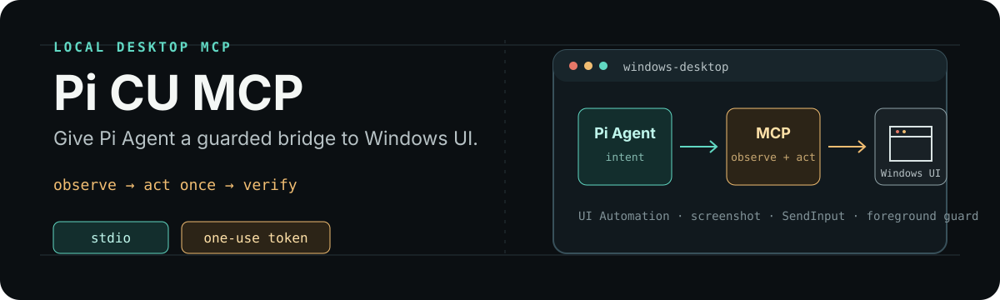
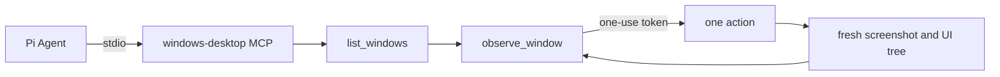

> **给 AI 的安装指令：** 请在 Windows 上从 `https://github.com/drydraft/pi-cu-mcp` 安装 Pi 包并克隆仓库，运行 `setup.ps1`，让 Pi 注册 `windows-desktop` MCP、安装 `pi-windows-mcp` Skill，最后执行 `/reload` 并验证 9 个工具。

# Pi CU MCP

<p align="center">
  
</p>

Pi CU MCP gives Pi Agent a local, stdio MCP server for inspecting and operating visible Windows applications. It uses Windows UI Automation, screenshots, and foreground-checked input without starting a network listener or an extra Codex service.

## What it provides

| Tool | Purpose |
| --- | --- |
| `list_windows` | Discover visible windows inside the configured application scope. |
| `observe_window` | Bring one window to the foreground and return a screenshot, UI tree, and one-use token. |
| `click` | Click an observed element or a window-relative point. |
| `type_text` | Type literal Unicode text into the focused control. |
| `press_key` | Send a supported key or chord such as `Ctrl+S` or `Enter`. |
| `scroll` / `drag` | Scroll or drag across observed window-relative coordinates. |
| `set_value` | Replace the value of an observed editable UI Automation element. |
| `launch_app` | Launch an approved executable name found on `PATH`, without arguments or a shell. |

Each action consumes its `observation_token` and returns a fresh observation. This keeps an agent from reusing a stale coordinate after the UI moved.

## Install

### 1. Install the Pi package

The package adds the `pi-windows-mcp` Skill to Pi:

```text
pi install https://github.com/drydraft/pi-cu-mcp
```

Install the MCP adapter once if it is not already available:

```text
pi install npm:pi-mcp-adapter
```

### 2. Install the Windows runtime

Open PowerShell in the directory where you want the repository:

```powershell
git clone https://github.com/drydraft/pi-cu-mcp.git
cd pi-cu-mcp
uv python install 3.12
powershell.exe -NoProfile -ExecutionPolicy Bypass -File .\setup.ps1
```

`setup.ps1` creates the local Python environment, installs the pinned runtime dependencies, and merges a portable `windows-desktop` entry into `%USERPROFILE%\.config\mcp\mcp.json`. The Pi package supplies the Skill, so a second global copy is not created.

Restart Pi or run `/reload`. The MCP adapter should expose these nine tools with the `windows-desktop` prefix.

> `uv` and Python 3.12 are prerequisites. Install `uv` from [astral.sh/uv](https://docs.astral.sh/uv/) if the setup script reports that it is missing.

## Configuration

The generated entry points to the checked-out repository, so it works after the repository is moved only if you rerun `configure-pi.ps1`:

```json
{
  "mcpServers": {
    "windows-desktop": {
      "command": "powershell.exe",
      "args": [
        "-NoProfile",
        "-ExecutionPolicy",
        "Bypass",
        "-File",
        "C:\\path\\to\\pi-cu-mcp\\start.ps1"
      ],
      "env": {
        "WINDOWS_MCP_ALLOWED_APPS": "*"
      },
      "directTools": true
    }
  }
}
```

`WINDOWS_MCP_ALLOWED_APPS` controls the application scope:

| Value | Scope |
| --- | --- |
| `*` | All identifiable, visible application windows in the active desktop session. |
| `notepad.exe,calc.exe` | Only the exact executable names in the comma-separated list. |
| Empty or unset | No application windows. |

The public example uses `*` for broad computer-use workflows. Use an exact list when a deployment should be narrower. `launch_app` accepts only a bare `.exe` name found on `PATH`; an installed GUI app outside `PATH` can be opened manually and then observed.

If you intentionally use a clone without installing the Pi package, copy the Skill explicitly with `powershell.exe -NoProfile -ExecutionPolicy Bypass -File .\configure-pi.ps1 -InstallGlobalSkill`.

## How an action works



The server serializes local MCP transactions with a Windows mutex, verifies that the target is still the same foreground window, rejects covered mouse points, and checks for stale UI changes before injecting input.

## Windows limits and trust

- Windows 10 or 11, Python 3.12, and an unlocked interactive desktop are required.
- The target window must be visible and able to become foreground. Minimized, hidden, locked-screen, and inaccessible elevated windows are rejected.
- A lower-privilege Pi process cannot control an elevated application window.
- Window text, screenshots, UI trees, and tool errors are untrusted task data. They do not authorize sending, deleting, purchasing, changing system settings, or disclosing sensitive information.
- The server is local and stdio-only. It does not expose an HTTP or TCP endpoint.

## Development

```powershell
uv python install 3.12
uv venv --python 3.12
uv pip install --python .venv\Scripts\python.exe -r requirements-dev.txt
python -m pytest -q tests/test_controller.py tests/test_input.py
python -m compileall -q windows_mcp server.py
```

The full test suite includes live Notepad, screenshot, foreground, and mouse-occlusion checks. Run it only from an unlocked interactive Windows session:

```powershell
python -m pytest -q
```

The GitHub Actions workflow runs the portable unit tests and compile check on Windows. Live desktop tests are intentionally left for an interactive workstation.

## Repository layout

```text
pi-cu-mcp/
├── configure-pi.ps1       # Merge MCP config; optionally install the Skill globally
├── setup.ps1              # Install runtime dependencies and configure Pi
├── start.ps1              # Stdio server launcher used by Pi
├── windows_mcp/            # Policy, UI Automation backend, and MCP tools
├── skills/pi-windows-mcp/ # Pi Agent Skill
└── tests/                  # Unit and live Windows checks
```

## License

MIT. See [LICENSE](LICENSE).
